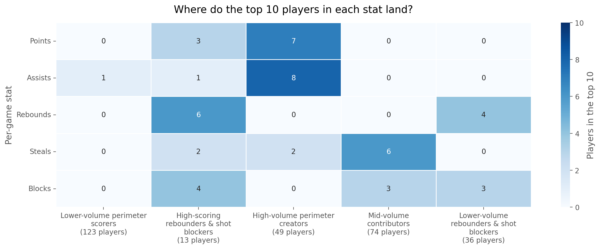

# NBA Player Segmentation

Basketball traditionally classifies players into five positions: point guard, shooting guard, small forward, power forward, and center. This project explores how NBA players can be grouped by their statistical profiles without using position labels. It also asks how those groups change when the analysis uses different sets of stats.

Stage 1 establishes a baseline using **17 traditional per-game box-score stats**. I used K-means to group **295 NBA players** from the **2024–25 regular season**.

[Open the Stage 1 notebook](notebooks/01_traditional_box_score.ipynb)

## Stage 1 findings

### The five player profiles

I used the five-cluster solution for the detailed analysis because it distinguished player roles that the three-cluster baseline grouped together. Of the 86 players in the baseline's high-volume scorers and creators group, 49 were assigned to high-volume perimeter creators, 13 to high-scoring rebounders and shot blockers, and 24 to mid-volume contributors. The added detail came with weaker average separation in the standardized data. The silhouette score was **0.193** for five clusters and **0.302** for three.

| Cluster label | Players | PTS | 3PA | AST | DREB | BLK | Example players |
| --- | ---: | ---: | ---: | ---: | ---: | ---: | --- |
| Lower-volume perimeter scorers | 123 | 8.46 | 3.84 | 1.93 | 2.42 | 0.32 | Alex Caruso, Jrue Holiday |
| High-scoring rebounders and shot blockers | 13 | 23.20 | 3.97 | 4.45 | 7.56 | 1.31 | Alperen Sengun, Victor Wembanyama |
| High-volume perimeter creators | 49 | 22.08 | 7.05 | 5.59 | 4.22 | 0.41 | Tyler Herro, Tyrese Maxey |
| Mid-volume contributors | 74 | 12.91 | 4.38 | 2.95 | 3.74 | 0.54 | Aaron Gordon, Fred VanVleet, Nikola Vučević |
| Lower-volume rebounders and shot blockers | 36 | 9.26 | 0.41 | 1.80 | 4.98 | 1.04 | Rudy Gobert, Ivica Zubac |

*The table shows cluster averages per game for points (PTS), three-point attempts (3PA), assists (AST), defensive rebounds (DREB), and blocks (BLK). The player examples are drawn from the notebook samples.*

### Two ways to contribute at 22–23 points per game

The **perimeter creators** averaged more three-point attempts (7.05 vs. 3.97) and assists (5.59 vs. 4.45). The **high-scoring rebounders and shot blockers** averaged more defensive rebounds (7.56 vs. 4.22) and blocks (1.31 vs. 0.41). The two groups scored at similar rates per game, but their shooting, playmaking, and interior contributions gave them distinct box-score profiles.

### Where the leaders landed



- **Scoring and playmaking.** The perimeter creators accounted for seven of the top ten scorers and eight of the top ten in assists.
- **Rebounding and shot blocking.** The 13-player high-scoring rebounding group contained six of the top ten rebounders. The other four came from the lower-volume rebounding group. Blocks leaders were spread across both rebounding groups and the mid-volume contributors.
- **Steals.** The mid-volume contributors accounted for six of the top ten in steals.

The rankings are within the 295 eligible players. They summarize where leaders in the model's input stats landed, with total rebounds combining the offensive and defensive rebound inputs.

## Data and method

- **Source.** NBA Stats via `nba_api`, using the 2024–25 regular-season traditional per-game endpoint. The analysis includes players with at least 40 games played and at least 15 minutes per game.
- **Features.** Seventeen inputs cover scoring, shooting attempts and percentages, playmaking, rebounding, and other box-score contributions. I used offensive and defensive rebounds separately and standardized the features before fitting K-means.
- **Model comparison.** I used the elbow curve and silhouette scores to compare candidate cluster counts. I then reviewed cluster averages, sampled players, and cross-tabulated the three- and five-cluster assignments.

## Limitations and next question

Per-game production reflects playing time and team responsibilities as well as player tendencies. Traditional box scores also capture only part of defensive contribution. In later stages, I plan to explore other statistical categories on the NBA Stats website, such as Advanced, Scoring, Usage, and Defense. I’ll compare those groupings with the traditional box-score baseline to see which player roles persist and which players or groups shift.

## Run the analysis

Install the notebook dependencies in a Python environment:

```bash
python -m pip install jupyterlab nba_api numpy pandas matplotlib seaborn scipy scikit-learn
python -m jupyterlab
```

Open `notebooks/01_traditional_box_score.ipynb` and run the cells in order. The data-loading cell requires internet access to retrieve the season stats from the NBA Stats API.
